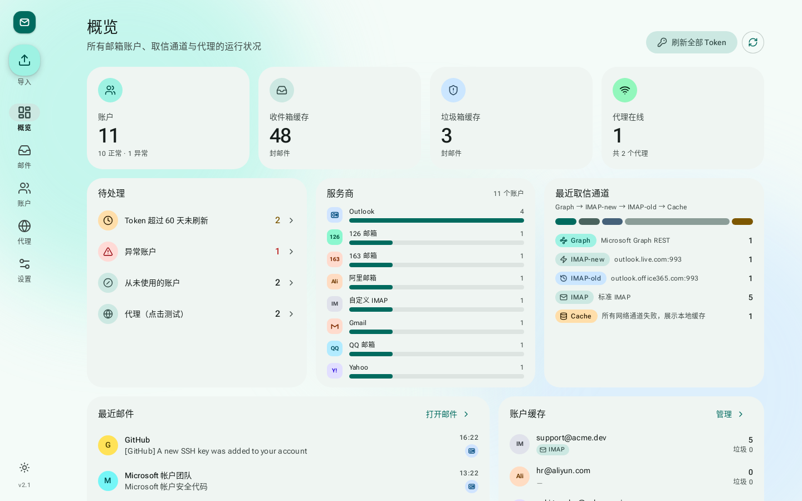
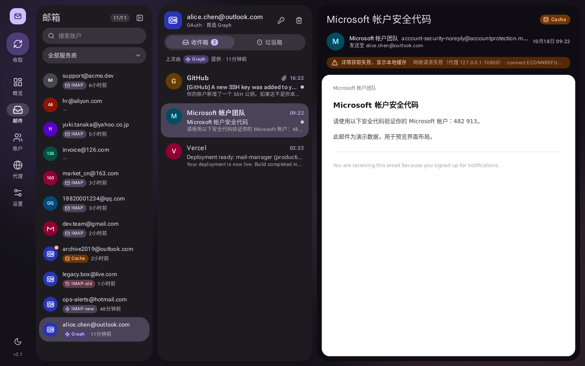
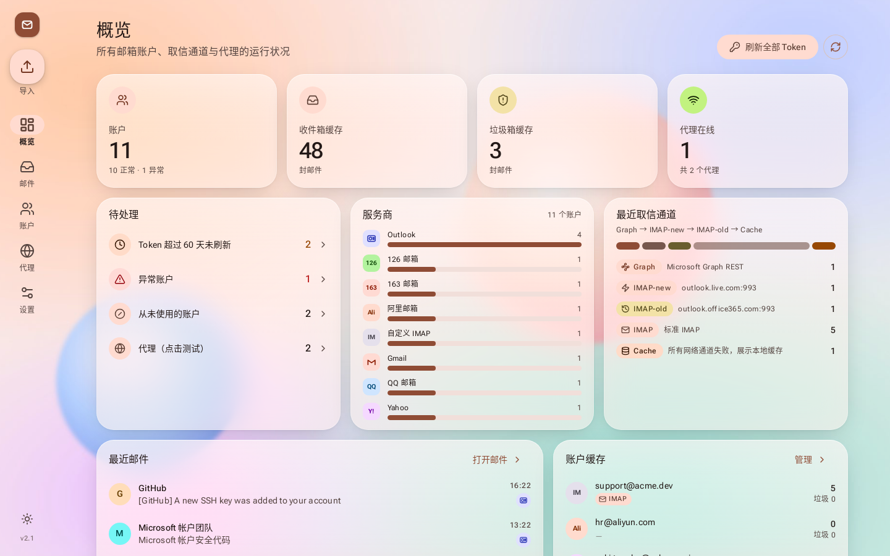
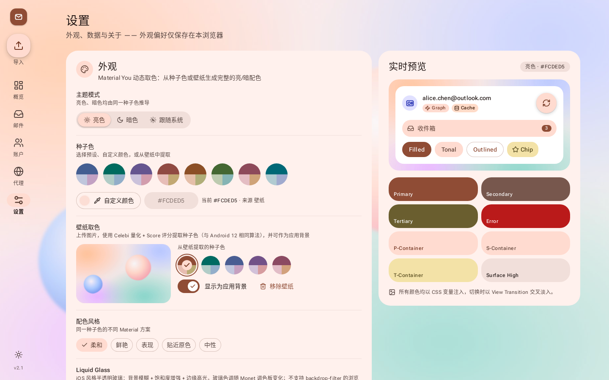

# Mail Manager · 多邮箱管理器（merged）

一个自托管的多邮箱管理面板：Outlook / Hotmail（OAuth：Graph + IMAP）与 Gmail、QQ、163、126、Yahoo、阿里邮箱、2925、自定义 IMAP 混合管理，统一收信、缓存、导入导出与代理。

本项目以 [keh4l/outlook-mail-manager](https://github.com/keh4l/outlook-mail-manager)（Koa + React）为基础，将 [assast/outlookEmail](https://github.com/assast/outlookEmail)（Flask）中的取信逻辑移植为 TypeScript，并重新设计了前端界面。





## 功能

- **概览**：账户 / 缓存 / 代理统计、待处理项（Token 超 60 天未刷新、异常、未使用）、服务商分布、最近取信通道分布、最近邮件
- **账户**：增删改查、搜索 / 服务商 / 状态筛选、标签、右键菜单、列显示设置、分页；批量导入（自动去重，跳过或覆盖）、按原生格式导出；数据库备份与恢复
- **Token 刷新**：单个账户或批量（并发 3）刷新；Outlook 刷新成功会写回微软轮换后的 refresh_token；IMAP 账户执行登录校验
- **邮件**：三栏视图（账户 → 列表 → 阅读），收件箱 / 垃圾箱，邮件详情、附件列表与下载，清空远端文件夹；每个账户和每封邮件都标注实际使用的通道（Graph / IMAP-new / IMAP-old / IMAP / Cache）
- **代理**：SOCKS5 / HTTP，测试出口 IP，设为默认；**所有通道都走代理**（OAuth、Graph、IMAP 新/旧、标准 IMAP）
- **访问密码**、移动端自适应（桌面 Navigation Rail / 移动端 Navigation Bar + 底部动作面板）
- **外观（设置 → 外观）**：Material You「Monet」动态取色 —— 8 个预设种子色、自定义取色器、上传壁纸自动提取种子色（Celebi 量化 + Score，与 Android 12 相同算法）并可作为应用背景；亮色 / 暗色 / 跟随系统均由同一种子色推导；5 种配色风格（Tonal Spot / Vibrant / Expressive / Content / Neutral）；可选 iOS 风格 **Liquid Glass** 半透明玻璃模式（不支持 `backdrop-filter` 时自动退化为实心表面）。所有外观偏好仅保存在浏览器 localStorage，无需后端
- **地址即状态**：邮件页的账户 / 邮件 / 文件夹都写在 URL 里（`/mail/:accountId/:mailId?box=Junk`），浏览器后退/前进、刷新、收藏都能还原；移动端「返回」逐级回到列表 → 账户，对话框/底部面板按返回键关闭；旧链接 `/mail?account=1` 自动跳转
- **动效**：Framer Motion 弹簧动画 —— 导航指示器共享布局、页面切换、列表错峰入场、邮件列表 → 阅读面板的容器变换（layoutId）、数字滚动、骨架屏微光；遵循系统「减少动态效果」设置



## 取信回退链（移植自 outlookEmail）

```
Outlook:   Graph API ──失败──▶ IMAP 新 (outlook.live.com) ──失败──▶ IMAP 旧 (outlook.office365.com) ──失败──▶ 本地缓存
普通 IMAP: IMAP ──失败──▶ 本地缓存
```

- 每个账户在 `accounts.preferred_channel` 中记录**上次成功的通道**，下次优先尝试：
  - 未记录 / `graph` → `graph → imap_new → imap_old`
  - `imap_new`（或源项目的 `imap`）→ `imap_new → imap_old → graph`
  - `imap_old` → `imap_old → imap_new → graph`
- 首选通道失败仍按上述顺序回退；成功后更新首选通道。`accounts.last_channel` 记录本次实际服务的通道（含 `cache`）。
- 与源项目一致：**Graph 阶段若为传输层错误**（代理 / 网络不通）立即停止网络回退并返回缓存，此时不把账户标记为异常。
- **Token 语义**：
  - Graph：`https://login.microsoftonline.com/common/oauth2/v2.0/token`，scope 逐级降级 `Mail.Read+ReadWrite+Send+User.Read → 去掉 Send → 仅 Read → .default`（仅在 `invalid_scope` / `consent_required` / `AADSTS70011` 等可重试错误时降级）
  - IMAP：`https://login.microsoftonline.com/consumers/oauth2/v2.0/token`，scope `https://outlook.office.com/IMAP.AccessAsUser.All offline_access`
  - Graph 与 IMAP 的 scope 永不混在同一请求中，避免 `AADSTS70011`
  - 微软返回新的 refresh_token 时立即写回数据库，同一次请求内后续通道使用新值；IMAP token 在新/旧两台服务器间复用
- **详情**：按抓取时的通道与 ID 模式获取。IMAP 列表使用 UID（`id_mode=uid`），详情优先按 UID 获取，失败回退序列号；UID 在新旧两台 Outlook IMAP 服务器上一致，详情会在两者之间互为回退。Graph 邮件使用 Graph message id。
- 普通 IMAP 连接后发送 IMAP ID（网易 163/126 必需），文件夹按服务商候选表（如 Gmail `[Gmail]/Spam`、QQ/网易 `&V4NXPpCuTvY-`）→ LIST special-use / 别名匹配解析。

## 导入格式

分隔符默认 `----`，每行一个账户，可在导入对话框选择服务商或「自动识别」。

| 类型 | 格式 | 示例 |
|---|---|---|
| Outlook（OAuth） | `email----password----client_id----refresh_token` | `a@outlook.com----pw----9e5f94bc-…----M.C5_BAY…` |
| Outlook（顺序反转） | `email----password----refresh_token----client_id` | 根据 UUID 自动识别 client_id |
| 预设 IMAP | `email----授权码` | `x@gmail.com----abcd efgh ijkl mnop` |
| 自定义 IMAP | `email----password----imap_host----imap_port` | `me@corp.com----secret----mail.corp.com----993` |

自动识别规则：含 UUID client_id 或超长 token 的行 → Outlook；第 4 段为端口 → 自定义 IMAP；两段 → 按邮箱域名匹配预设服务商（gmail.com / qq.com / foxmail.com / 163.com / 126.com / yahoo.* / aliyun.com / 2925.com）。导出时每种账户输出其原生格式，可直接再次导入。

预设 IMAP 主机：Gmail `imap.gmail.com`、QQ `imap.qq.com`、163 `imap.163.com`、126 `imap.126.com`、Yahoo `imap.mail.yahoo.com`、阿里 `imap.aliyun.com`、2925 `imap.2925.com`，端口均为 993。

## 快速开始

需要 Node.js ≥ 20。

```bash
npm run install:all     # 安装根目录 / server / web 依赖
cp .env.example .env    # 按需修改端口、访问密码、超时
npm run build           # 构建前端（web/dist，由后端静态托管）
npm start               # 启动 http://localhost:3000
```

开发模式：`npm run dev`（后端 3000 + Vite 5173，自动代理 /api）。

其他命令：

```bash
npm run typecheck       # server: tsc --noEmit
npm test                # server: 回退链 / token 轮换 / 导入解析单元测试（全部 mock，不联网）
cd server && DB_PATH=./data/demo.db npx tsx scripts/seed-demo.ts   # 生成演示数据（虚构账户）
BASE=http://localhost:3000 node web/e2e/nav.spec.mjs              # 导航/返回/转场 Playwright 巡检（需自行安装 playwright，非 CI）
cd server && DB_PATH=./data/demo.db npx tsx scripts/seed-edge.ts   # 追加 QA 边界数据（EDGE_BULK=200 追加 200 个账户）
BASE=http://localhost:3000 node web/e2e/v24.spec.mjs              # v2.4 回归（见文件头的准备步骤）
```

### 数据库迁移

启动时自动执行。v2 迁移只做 `ADD COLUMN` / `CREATE INDEX`，**保留全部旧数据**：旧账户自动视为 `provider='outlook'`、`account_type='outlook'`；新增 `imap_host/imap_port/imap_password/preferred_channel/last_channel/last_channel_at/last_error`；邮件缓存新增 `id_mode/channel/attachments/has_attachments/to_addr`，并先去重再建立 `(account_id, mailbox, mail_id)` 唯一索引（修复旧版缓存重复插入）。

## 新增 / 变更的 API

| 方法 | 路径 | 说明 |
|---|---|---|
| GET | `/api/accounts/providers` | 服务商预设表 |
| GET | `/api/accounts?provider=&status=&search=` | 列表支持筛选 |
| POST | `/api/accounts` | 新建；`provider` 为 outlook 时需 `client_id`+`refresh_token`，否则需 `imap_password`（custom 还需 `imap_host`/`imap_port`） |
| POST | `/api/accounts/import-preview` · `/import-confirm` | 新增 `provider`（auto/outlook/gmail/…/custom）、`account_format`；旧版 `format` 字段顺序仍兼容 |
| POST | `/api/accounts/:id/refresh-token` | 刷新单个账户 Token / IMAP 登录校验 |
| POST | `/api/accounts/refresh-tokens` | 批量刷新，`{ ids?: number[] }`，为空则全部 |
| POST | `/api/mails/fetch` | `{ account_id, mailbox: 'INBOX'\|'Junk', proxy_id?, top? }`；返回 `channel`（graph/imap_new/imap_old/imap/cache）、`errors`；整次收取受 `FETCH_TIMEOUT` 限制，超时返回「收取超时」（有缓存时返回缓存 + `errors.timeout`） |
| GET | `/api/version` | `{ version, webBuildVersion, match }`：`VERSION` 文件与 `web/dist/.version`（已构建前端）的版本，无需登录 |
| GET | `/api/mails/:id/detail` | 按通道 + ID 模式拉取详情与附件列表，失败返回缓存并带 `detail_error` |
| GET | `/api/mails/:id/attachments/:attachmentId` | 附件下载（Graph attachment id 或 IMAP `idx-N`） |

## 目录结构（关键模块）

```
server/src/
  providers/presets.ts        服务商预设、域名映射、文件夹候选表（移植）
  services/FetchChain.ts      通道顺序与回退执行器
  services/MailService.ts     取信主流程、详情、附件、清空、Token 刷新（含 TokenSession 轮换写回）
  services/OAuthService.ts    Graph / IMAP token 刷新，scope 降级，test_refresh_token 语义
  services/GraphApiService.ts Graph 列表 / 详情 / 附件 / 删除
  services/ImapService.ts     imapflow：XOAUTH2 / LOGIN、IMAP ID、文件夹解析、UID 详情、附件
  services/ImportParser.ts    导入解析（含 client_id/refresh_token 顺序自动识别）与导出格式
  utils/http.ts               undici 出站层：HTTP 代理 ProxyAgent，SOCKS5 自定义 connector
server/tests/fallback.test.ts 单元测试
web/src/lib/monet.ts          Material You 动态取色：种子色 → M3 方案 → CSS 变量；壁纸取色；主题切换过渡
web/src/stores/appearance.ts  外观设置（localStorage）：模式 / 种子色 / 配色风格 / 壁纸 / Liquid Glass
web/src/pages/Mail.tsx        三栏邮件视图（可折叠账户栏，layoutId 容器变换）
web/src/stores/fetchQueue.ts  唯一的收取引擎：账户+文件夹任务去重、4 并发、取消、只刷新正在查看的列表、提示策略
web/src/pages/Settings.tsx    设置（外观 / 数据 / 关于）
web/src/components/common/    M3 基础组件（Button / Input / Switch / Checkbox / Dialog·BottomSheet / Badge / ChannelBadge / ProviderIcon / Ripple）
web/src/components/layout/    Navigation Rail / Navigation Bar / FAB / 背景
```

## 已知限制

- 未实现源项目中的分组、定时自动刷新、转发、临时邮箱、分享链接、浏览器扩展、OAuth 授权助手等功能
- 代理仅支持单一代理（请求指定或默认），未移植源项目的多级代理故障转移
- 数据库恢复需重启服务后生效（重启时自动替换，原库保留为 `.backup-<时间>`）
- 每次收取取每个文件夹最新 50 封；本地缓存在邮件列表中每次加载 100 封（「加载更多」）

## 致谢与许可

- 基础项目：[keh4l/outlook-mail-manager](https://github.com/keh4l/outlook-mail-manager) — MIT License
- 取信逻辑来源：[assast/outlookEmail](https://github.com/assast/outlookEmail) — MIT License

本合并版本同样以 MIT License 发布，详见 [LICENSE](LICENSE)，并保留上述原项目的版权声明。

## 一键启动

需要 Node.js 20+（20 / 22 / 24 均可）。脚本会自动：检查 Node → 生成 `.env` → 首次安装依赖 → 构建前端 → 启动服务并自动打开浏览器。

| 系统 | 方式 |
| --- | --- |
| Windows | 双击 `start.bat`（没装 Node 会尝试用 winget 安装） |
| macOS | 双击 `start.command`，或终端运行 `./start.sh`（没装 Node 会尝试用 Homebrew 安装） |
| Linux | `./start.sh` |

改了前端代码想强制重新构建：`start.bat rebuild` / `./start.sh rebuild`。端口在 `.env` 的 `PORT` 修改（默认 3000）。

启动窗口会打印「App version / Frontend build」两个版本号，服务端日志第一行也会打印 `Mail Manager vX | frontend build: vY`。
网页左侧导航栏底部显示的是**当前页面（前端）**的版本；如果它和服务端版本不一致，页面顶部会出现红色提示
「前端版本与服务端不一致，请关闭所有命令窗口后重新运行 start.bat rebuild」。

### 升级 / 排查「新功能看不到 / 不能用」

1. 关闭所有 Mail Manager 命令窗口（任务管理器里也可以结束残留的 `node.exe`）。
2. 把新 zip 解压到**一个新文件夹**（或覆盖旧文件夹；注意不要解压成 `merged-mail-manager\merged-mail-manager` 嵌套目录，脚本会对此给出警告）。
3. 双击新文件夹里的 `start.bat`；看窗口里的 `App version` 与 `Frontend build` 是否都是新版本。
4. 浏览器访问 `http://localhost:端口/api/version`，`version` 与 `webBuildVersion` 应一致且为新版本；网页导航栏底部版本也应相同。

### 超时设置（`.env`）

| 变量 | 默认 | 说明 |
|---|---|---|
| `FETCH_TIMEOUT` | 45 | 单个账户单个文件夹一次收取的**总时限**（含 Graph → IMAP 新 → IMAP 旧 全部回退）。到时强制断开并返回「收取超时」，批量收取不会卡住 |
| `HTTP_REQUEST_TIMEOUT` | 20 | 单个 OAuth / Graph 请求超时 |
| `IMAP_TIMEOUT` | 20 | IMAP 连接超时（问候 ≤15 秒，空闲 ≥30 秒） |

前端对每个收取请求另有 120 秒兜底超时。

## v2.5 更新（2026-10-24）· 收取逻辑

之前有两套互相不知道对方的收取状态（单账户收取 + 批量收取），同一个账户 + 文件夹可能被同时请求两次；邮件页上同一个动作有 2–3 个入口、文案不一（「全部重新获取」实际只是收件箱 + 垃圾箱）。v2.5 重做为**一个收取引擎**（`web/src/stores/fetchQueue.ts`）：

- **任务 = 账户 + 文件夹**，自动去重：同一任务已在排队 / 进行中时，再点只会「加入」它，不会重复请求（双击也一样）；手动收取一个排队中的账户会把它提到队首。
- **固定 4 并发**，同一账户的两个文件夹不同时进行；每个任务可单独取消，也可「全部取消」（取消只是不再等待，服务端那一次收取仍会写入缓存）。
- 任务结束时**只刷新正在查看的那个列表**：收取中途切换账户 / 文件夹，结果不会覆盖别的列表。
- **提示**：单个账户的收取提示它自己的结果；批量收取（≥ 2 个账户）只在结束时提示一次汇总；**进度面板只在批量收取时出现**。
- **入口**（每个页面同一动作只出现一次，所有入口显示同一个进度，运行中仍可点击 = 追加，不会重复）：

| 页面 | 入口 | 作用范围 |
|---|---|---|
| 邮件 · 列表头部 | 「收取」 | 当前账户的当前文件夹 |
| 邮件 · 列表头部菜单 | 「收取收件箱和垃圾箱」/「取消收取」（进行中时） | 当前账户 |
| 邮件 · 账户栏 | 「收取全部 (n)」（收起时为图标） | 账户栏搜索 / 服务商筛选后的账户 |
| 账户 | 「收取选中 (n)」/ 无选中时「收取全部 (n)」 | 选中的账户 / 当前筛选下的全部账户 |
| 概览 | 「收取全部」 | 全部账户 |
| 进度面板 | 每行「取消」、「全部取消」 | 单个账户 / 全部任务 |

- 邮件页不再把导航栏 FAB 改成「收取」（保持「导入」）；删除未使用的 `mailApi.fetchNew`（服务端 `/api/mails/fetch-new` 保留）。

## v2.4 更新（2026-10-22）

全面 QA（真实服务端 + 边界数据：0 / 1 / 235 个账户、超长主题、脚本 / 超大图片 / 超宽表格 HTML、纯文本长 URL、附件、emoji、空库、访问密码；1920×1080、1366×768、1280×720 @125% / @150%、768、390；亮 / 暗 / Liquid Glass）后修复：

- **邮件阅读**：超长主题最多 3 行（悬停看全文），不再把正文挤出可视区域；附件 chip 不再折行、大小为 0 时不显示「0 B」；纯文本邮件的长 URL 自动换行且可点击；HTML 邮件写入 iframe 前移除 `<script>`、`on*` 事件、`<meta refresh>`、`<base>`（控制台不再刷「Blocked script execution」，邮件的 `<base href>` 不再劫持链接），链接新标签页打开（noopener）；日期按 UTC 正确解析，非今年的邮件显示年份；emoji 发件人头像不再显示为 �。
- **已读状态**：打开邮件即标记已读（列表圆点与收件箱未读数立即更新，服务端缓存同步写入；重新收取不会把本地已读变回未读）。
- **邮件列表**：本地缓存超过 100 封时底部显示「加载更多」；窗口宽度 < 1440（含 1920×1080 @150%）时账户栏默认收起，阅读面板更宽；空库时邮件页提供「导入账户」按钮，筛选无结果时提供「清除筛选」。
- **账户**：翻页 / 改筛选后清空选择（之前切到第 2 页仍显示「已选 10 项」，批量删除 / 导出会作用到看不见的账户）；表头全选框按当前页判断；# 列跨页连续编号；删除最后一页唯一一条后自动回到上一页；快速输入搜索时旧响应不再覆盖新结果；≤3 位的短密码 / 授权码也会被遮挡；表头与长标签不再折行重叠；移动端工具栏按钮换行不被裁掉；导出在 0 个账户时禁用。
- **编辑账户**：在对话框里切换标签（或后台刷新账户数据）不再清空正在输入的内容；右键菜单切换标签后勾选状态立即更新，滚动 / 缩放窗口时自动关闭。
- **复制**：通过局域网 IP（http）访问时 `navigator.clipboard` 不可用，点击复制会抛异常 —— 现回退到 `execCommand('copy')` 并给出结果提示。
- **导入**：支持 UTF-16（记事本「Unicode」）与 GBK/GB18030 编码的 txt/csv；再次选择同一个文件也能重新读取；支持拖入文件。
- **访问密码**：登录框显示时不再在背后渲染页面（之前会弹出一串「加载账户失败：Unauthorized」）；Token 过期时只显示登录框；网络错误不再被误报为「密码错误」。
- **批量收取**：运行中追加的账户恢复到 4 并发（之前只剩一个 worker 在跑）；进度面板显示时页面底部留白，分页按钮不再被面板挡住。
- **数据库恢复**：上传的备份先保存为 `<db>.restore`，**下次启动时**在打开数据库之前替换（原库连同 -wal/-shm 移为 `.backup-<时间>`）。之前直接覆盖正在使用的 WAL 数据库文件，重启后旧 WAL 会被回放到新库上导致数据错乱；恢复接口的上传上限放宽到 512 MB（之前 10 MB，约 7.5 MB 以上的库无法恢复）。
- 其他：设置页没有壁纸时「显示为应用背景」开关显示为关闭；概览「刷新全部 Token」在 0 个账户时禁用；「x 秒前」不再出现负数；附件 / 备份 / 导出下载延迟释放 Blob URL；分页参数非法时服务端不再报 SQL 错误。
- 测试：新增 `web/e2e/v24.spec.mjs`（reader / accounts / mail / misc / auth）与 `server/scripts/seed-edge.ts` 边界数据；`server/tests/restore.test.ts`。

## v2.3 更新（2026-10-20）

- 修复：收取可能**无限挂起**——IMAP 服务器/代理持续返回数据（keepalive、极慢的 FETCH）时 imapflow 的空闲超时永不触发，单次收取实测挂起 700 秒以上直到进程被结束，批量收取进度因此永远不结束。新增整次收取总时限 `FETCH_TIMEOUT`（默认 45 秒，`server/src/utils/deadline.ts`）：到时强制关闭 IMAP 连接、中止 OAuth/Graph 请求，返回可读的「收取超时」错误；超时不会把账户标记为异常。前端收取请求增加 120 秒兜底超时。
- 修复：同一次收取中 IMAP(新)/IMAP(旧) 各自重复刷新一次 IMAP token（refresh_token 无效或 OAuth 端点不通时白白多等一轮），现共用一次结果。
- 改进：微软 OAuth 错误去掉 Trace ID / Correlation ID 噪音并附中文提示（如 AADSTS70000 → refresh_token 无效或已失效）；收取错误前缀改为「收取失败：」。
- start.bat 重写：不再用 `powershell -WindowStyle Hidden`（与 `start /b` 共享控制台时可能把启动窗口本身隐藏，服务在看不见的窗口里继续运行、无法关闭，旧版本便一直提供旧界面）；改用 `scripts/open-browser.cjs` 打开浏览器。版本比较改用 `for /f` 读取（不依赖 `fc`）；停止旧实例按 PID 去重（IPv4/IPv6 两行同一 PID 不再误报"端口被其他程序占用"），与系统语言无关；检测嵌套解压目录；启动时打印应用版本与前端构建版本。
- 诊断：`GET /api/version`；服务端启动日志打印两个版本，不一致时警告；端口被占用时给出明确提示；导航栏显示前端构建版本（来自 VERSION，不再写死），与服务端不一致时页面顶部显示可关闭的提示横幅。
- 构建：`vite build` 自动写入 `web/dist/.version`。

## v2.2 更新（2026-10-20）

- 邮件页账户栏新增文字按钮「批量收取」；start 脚本按 VERSION 文件自动判断是否需要重新构建前端（解压覆盖旧目录也会自动重建）。

## v2.1 更新（2026-10-20）

- 修复：导入邮箱后页面无法点击（弹窗退出动画卡住导致透明遮罩残留），新增 `lib/overlayGuard.ts` 兜底清理。
- 修复：收信后切换页面空白。所有接口数据经 `lib/normalize.ts` 清洗；全局与页面级错误边界（重试 / 返回概览），错误上报到 `POST /api/client-log`；离开页面自动取消请求。
- 新增：批量收取邮件（4 并发、可取消、进度面板），入口在账户页、邮件页、概览页。
- 新增：M3 分体「收取」按钮（收取新邮件 / 全部重新获取 / 收取所有账户）。
- 测试：`web/e2e/bugs.spec.mjs`（import / stack / fetch / api / crash / batch）与 `web/e2e/nav.spec.mjs`。QA 钩子：`localStorage['mm-qa-crash']` 设为某路由会故意触发错误卡片，正常使用不受影响。
